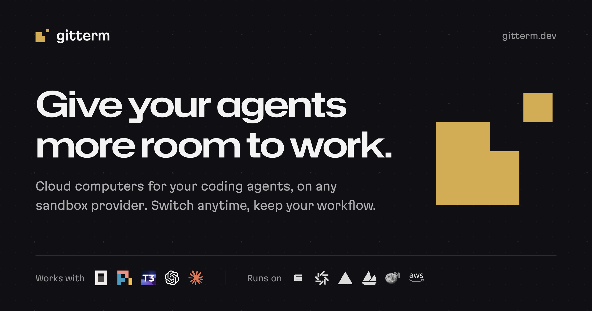

# GitTerm

- **Remote sandboxes:** Run builds, tests, and previews from OpenCode, Pi, Codex, or Claude Code. Codex and Claude Code work on their own or inside T3 Code.
- **Cloud workspaces:** Run OpenCode, Pi, or T3 Code itself in the cloud. In a T3 Code workspace, you can start a Codex or Claude Code thread and open it from another device.

[Website](https://gitterm.dev) · [Docs](https://gitterm.dev/docs) · [Contributing](CONTRIBUTING.md)

## Get started

Set up GitTerm for your agents with Node.js 22.12 or newer:

```sh
npx @gitterm/cli setup
```

Use a GitTerm account or bring your own provider key, then ask your agent to run your tests in a sandbox. See the [sandbox setup guide](https://gitterm.dev/docs/sandboxes/setup) or [how to move a session to the cloud](https://gitterm.dev/docs/workspaces/move-a-session).

You can also [start a cloud workspace from the dashboard](https://gitterm.dev/docs/workspaces/overview), use the [TypeScript SDK](packages/sdk), or connect an agent to [Slack](packages/slack-bot) or [Discord](packages/discord-bot).

## Self-host

Deploy GitTerm on your own infrastructure with [Docker Compose or Railway](https://gitterm.dev/docs/self-hosting/overview). You bring your own provider and model credentials.

[](https://railway.com/deploy/gitterm?referralCode=o9MFOP&utm_medium=integration&utm_source=template&utm_campaign=generic)

## License

[MIT](LICENSE). GitTerm is independent of OpenCode and T3 Code.

[](https://e2b.dev/startups)
